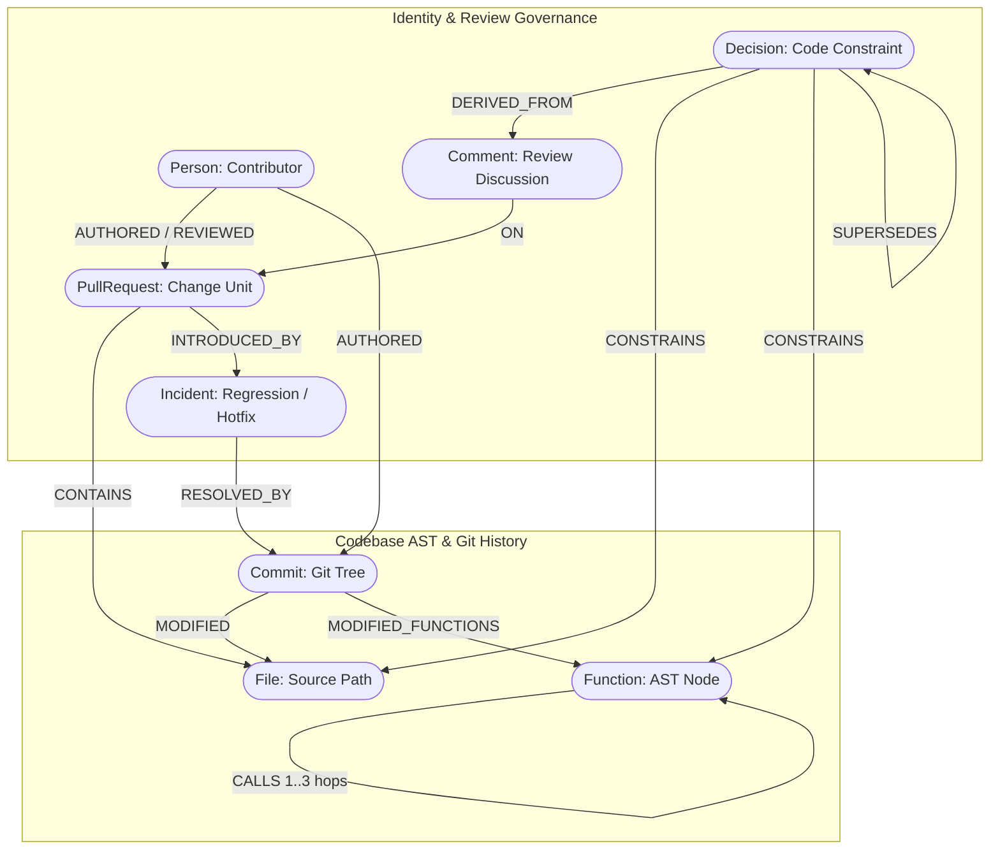

# Stop Merging Blind: How We Built a Temporal Architectural Knowledge Graph with FalkorDB & Next.js

Every developer knows the sinking feeling of deploying a seemingly harmless **two-line pull request** that knocks production offline.

```typescript
// "Just a tiny refactor, what could go wrong?"
export function resolveConfig(inlineConfig: InlineConfig) {
  return mutateConfigInPlace(inlineConfig);
}
```

Two hours later, an incident postmortem reveals a painful truth: **nine months ago in PR #1402, a senior engineer explicitly commented:**

> *"NEVER mutate the inline config descriptor in place—it breaks downstream plugin pipeline watchers and Vite SSR hydration."*

That critical architectural constraint was buried in GitHub comment history. The author didn't know. The reviewer didn't know. The unit tests didn't catch it. And today's AI coding tools (Cursor, Copilot, Claude Code) didn't catch it either, because **standard vector RAG treats codebases as static text chunks, completely blind to call-graph topology and temporal decision history**.

To solve this, we built **[Provenance](https://github.com/CodewithEvilxd/provenance)** — an open-source **Bi-Temporal Architectural Knowledge Graph & Change Risk Intelligence Engine** powered by **FalkorDB**, **Next.js 16**, **Tree-sitter AST**, and the **Model Context Protocol (MCP)**.

---

## 🎨 System Architecture at a Glance

Here is how Provenance connects Git history, AST call graphs, review discussions, and AI agents into a single unified intelligence platform:


### Core Architecture Components:

1. **Source Code & Git VCS Ingestion**: Parses AST trees via **Tree-sitter**, extracts function line boundaries, maps commit diff hunks, and links GitHub PR review comments.
2. **FalkorDB GraphBLAS Engine**: Stores sparse adjacency matrices for multi-hop call graphs, runs vector similarity on constraints, and enforces strict bi-temporal cutoff boundaries ($t \le t_{cutoff}$).
3. **Agent & Intelligence Layer**: Evaluates 5-channel change risk, calculates contributor ownership and Lorenz Bus Factor ($B_{50}$), and traces decisions.
4. **Model Context Protocol (MCP) Server**: Exposes 10 native reasoning tools to Cursor, Claude Desktop, and Gemini Code Assist.
5. **Next.js 16 Web Dashboard**: Real-time visual reviews, interactive graph subgraphs (`@xyflow/react`), bus factor heatmaps, and timeline scrubbers.

---

## 🚀 The Web App in Action

We built a modern, tactical dashboard with Next.js 16 and React 19 to make codebase risk immediately intuitive.

### 1. PR Change Risk Review Dashboard
When a PR is opened, Provenance traverses the graph in **<38ms**, evaluating blast radius, active constraints, and past regression links:


Notice how every flagged decision links directly to the **cryptographic GitHub review comment URL** where the decision was originally born!

---

### 2. Historical Time Slider: Zero Future Leakage
Have you ever tried benchmarking an evaluation model, only to realize your tool leaked tomorrow's commits into yesterday's assessment?

Provenance implements strict bi-temporal filtering (`valid_from <= $asOf` and `valid_to > $asOf`). Moving the slider scrubs the repository back to any exact millisecond in git history:


---

### 3. Contributor Ownership & Lorenz Bus Factor ($B_{50}$)
Who actually knows this code? Provenance computes Lorenz cumulative commit distribution across repository modules, filtering automated bots (`dependabot`, `renovate`) to calculate genuine human Bus Factor:


$$\text{Bus Factor } (B_{50}) = \min \left\{ k \;\middle|\; \sum_{i=1}^k S_i \ge 50\% \right\}$$

---

## 🧠 Why Standard RAG Fails (And Why GraphBLAS Wins)

When teams attempt to give AI agents codebase context, they usually embed file chunks into a vector database:

$$\text{User Query} \xrightarrow{\text{Cosine Similarity}} \text{Top 5 Chunks} \xrightarrow{\text{LLM Context}}$$

This fails catastrophically for architectural change risk:

| Dimension | Standard Vector RAG | Provenance (FalkorDB Property Graph) |
|---|---|---|
| **Multi-Hop Blast Radius** | Cannot traverse caller-callee chains across files | Traverses 3 hops in `<38ms` via GraphBLAS sparse matrix multiplication |
| **Constraint Supersession** | Returns old and new conflicting rules | Traverses `NOT (d)<-[:SUPERSEDES]-(:Decision)` to prune obsolete rules |
| **Historical Cutoff** | Contaminates past code with future commits | Enforces strict point-in-time isolation ($t \le t_{cutoff}$) |
| **Evidence Traceability** | Hallucinates or guesses source files | Cryptographic path: `(Decision)->(Comment)->(PR)->(File)` |

---

## 🛠️ The Graph Data Model

We modeled the entire software engineering lifecycle into **10 Node Labels** and **11 Relationships**:



### Key Cypher Queries Powering Provenance

#### 1. Multi-Hop AST Blast Radius Exploration
```cypher
MATCH path = (caller:Function)-[:CALLS*1..3]->(target:Function)
WHERE target.id IN $functionIds
RETURN caller.id AS callerId, caller.name AS callerName,
       target.id AS targetId, length(path) AS depth
LIMIT 50
```

#### 2. Active Decisions with Supersession Exclusion
```cypher
MATCH (d:Decision)-[c:CONSTRAINS]->(target)
WHERE target.id IN $targetIds
  AND NOT (d)<-[:SUPERSEDES]-(:Decision)
  AND (d.decided_at IS NULL OR d.decided_at <= $cutoff)
OPTIONAL MATCH (d)-[:DERIVED_FROM]->(src:Comment)
RETURN d.id AS id, d.summary AS summary, d.reason AS reason,
       c.strength AS strength, src.url AS sourceUrl
```

#### 3. Storage-Level Atomic Webhook Task Claiming
To eliminate concurrency race conditions when GitHub fires duplicate webhook events, FalkorDB executes an atomic Redis-level `MERGE`:

```cypher
MERGE (t:Task {id: $id})
ON CREATE SET t.status = 'running', t.created_at = $now, t.updated_at = $now
ON MATCH SET
  t.claim_action = CASE
    WHEN t.status = 'failed' THEN 'retried'
    ELSE 'ignored'
  END,
  t.status = CASE
    WHEN t.status = 'failed' THEN 'running'
    ELSE t.status
  END
RETURN t.status AS status, t.claim_action AS action
```

---

## 📐 The 5-Channel Change Risk Algorithm

Provenance calculates risk across 5 mathematically normalized channels:

$$\text{Risk Score} = \max\left(\text{floor}, 100 \times \frac{\sum w_i \cdot c_i}{\sum w_i}\right)$$

1. **Blast Radius Channel ($w=0.25$):** Normalized logarithmic caller depth: $\min(1, \frac{\ln(1 + \text{blastRadius})}{\ln(41)})$.
2. **Incident History Channel ($w=0.30$):** Historical bug/revert recurrence: $\min(1, \frac{\text{weightedIncidents}}{3})$.
3. **Constraint Violation Channel ($w=0.25$):** $1.0$ for hard rule violation, $0.6$ for soft rule violation, $0.2$ for constrained touch.
4. **Author Familiarity Channel ($w=0.10$):** Author unfamiliarity in target module: $1 - \min(1, \frac{\text{authorKnowledge}}{5})$.
5. **Change Size Channel ($w=0.10$):** Diff volume normalization: $\min(1, \frac{\text{linesChanged}}{800})$.
6. **Floor Rule:** A hard rule violation or direct 12-month incident enforces a hard minimum floor of **30** (ensuring high visibility).

---

## 🤖 Bringing Graph Intelligence to AI Agents via MCP

AI coding assistants shouldn't code in the dark. Provenance embeds **10 native Model Context Protocol (MCP)** tools over `stdio`:

```typescript
// Registering MCP tools for Cursor & Claude Desktop
server.registerTool("assess_change_risk", {
  description: "Assess an indexed target using graph evidence before applying patch.",
  inputSchema: riskInput.shape,
  outputSchema: assessOutputSchema
}, async ({ repo, target, changedFiles }) => {
  return assessChangeRisk(`repo:${repo}`, target, changedFiles);
});
```

When an agent inside Cursor plans to refactor `resolveConfig`, it queries `explain_code_constraint` and immediately gets warned:

> ⚠️ **Warning from Provenance Graph**: `resolveConfig` is constrained by Decision #42 (*"Never mutate inline config in place"* born in PR #1402). Downstream blast radius: 14 callers.

---

## 📊 Real-World Benchmark: 21 PRs on `vitejs/vite`

We validated Provenance against 21 real pull requests from `vitejs/vite` strictly as of their merge-time cutoffs:

| Metric | Measured Value | Meaning |
|---|:---:|---|
| **Accuracy** | **81.0%** (17 / 21) | Correct classification of risky vs benign changes |
| **Precision** | **87.5%** (7 / 8) | High confidence that flagged changes are genuine regressions |
| **Recall** | **70.0%** (7 / 10) | Correctly caught 7 out of 10 historical regressions |
| **False Positive Rate** | **9.1%** (1 / 11) | Minimal noise on routine feature & doc PRs |
| **F1 Score** | **0.778** | Balanced harmonic precision-recall performance |

---

## 🏁 Try It Yourself

Provenance is open source and ready to run locally:

```bash
# 1. Clone & install dependencies
git clone https://github.com/CodewithEvilxd/provenance.git
cd provenance
pnpm install

# 2. Launch FalkorDB
docker compose up -d

# 3. Setup environment
cp .env.example .env.local

# 4. Start Next.js Web Dashboard
pnpm --filter @provenance/web dev
```

Open [http://localhost:3100](http://localhost:3100) to explore the live Vite benchmark review, scrub through historical timelines, or inspect module bus factors!

---

## 💬 Join the Discussion

- How does your team currently preserve decisions made in PR review threads?
- Have you integrated graph databases with AI coding agents?

Drop your thoughts in the comments below! If you found this useful, star the repo on **[GitHub](https://github.com/CodewithEvilxd/provenance)**! ⭐
